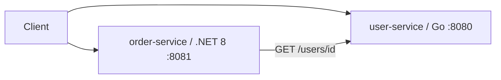

# Cloud-Native Microservices Platform

Go user API and .NET 8 order API. Creating an order calls user-service to confirm the user exists. Data is in-memory. Run locally with Compose; the same images can go to Kubernetes.



## Local run

Needs Docker Compose.

```bash
docker compose up --build -d
python3 scripts/smoke_test.py
```

On Windows, `python` works if `python3` is not installed.

```bash
curl http://localhost:8080/users
curl http://localhost:8081/orders

curl -X POST http://localhost:8080/users \
  -H 'Content-Type: application/json' \
  -d '{"name":"Jeff","email":"jeff@example.com"}'

curl -X POST http://localhost:8081/orders \
  -H 'Content-Type: application/json' \
  -d '{"userId":1,"product":"Mechanical Keyboard","quantity":2}'
```

```bash
docker compose down
```

`make up`, `make test`, and `make down` do the same thing.

## API

User service (`:8080`): `GET /health`, `GET /users`, `GET /users/{id}`, `POST /users`

Order service (`:8081`): `GET /health`, `GET /orders`, `GET /orders/{id}`, `POST /orders`

`POST /orders` fails if the user id is missing or user-service is down.

## Tests

```bash
make test-unit
make test
```

Unit tests: `go test ./...` in `services/user-service`, `dotnet test` in `services/order-service`. Smoke test needs Compose running.

## Kubernetes

```bash
kubectl apply -f deploy/k8s/namespace.yaml
kubectl apply -n portfolio-microservices -f deploy/k8s/user-service.yaml
kubectl apply -n portfolio-microservices -f deploy/k8s/order-service.yaml
```

Publish images first and point the manifests at them.

## Terraform

Deploys into the cluster in your current kubeconfig.

```bash
cd infra/terraform
terraform init
terraform apply
```

```bash
terraform apply \
  -var='user_image=YOUR_USER_IMAGE' \
  -var='order_image=YOUR_ORDER_IMAGE'
```

## CI

Pushes to `main` and pull requests run three jobs: Go/.NET unit tests, `terraform fmt` + `validate`, and a Compose smoke test.
